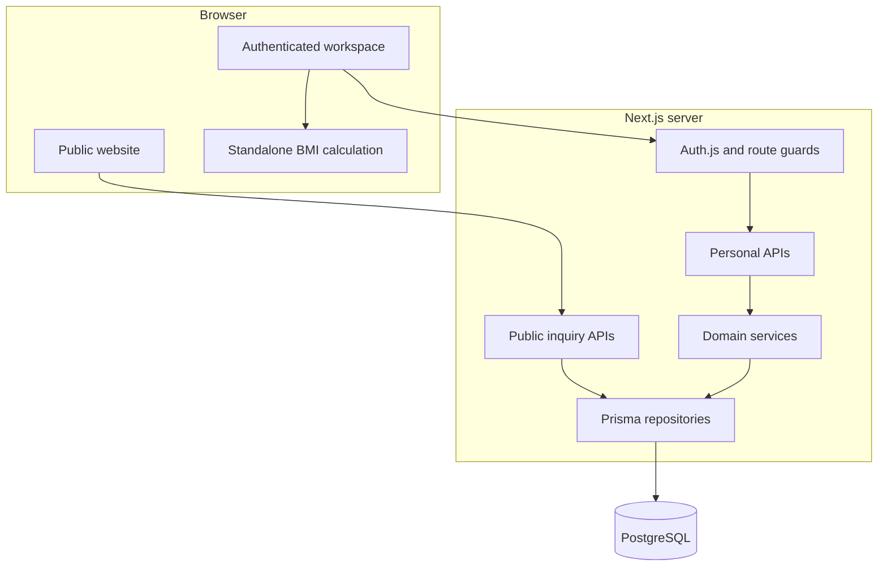
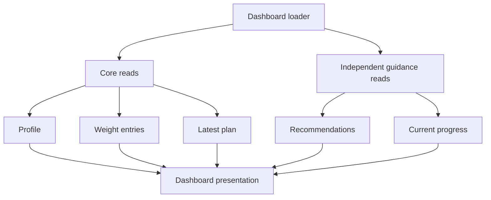
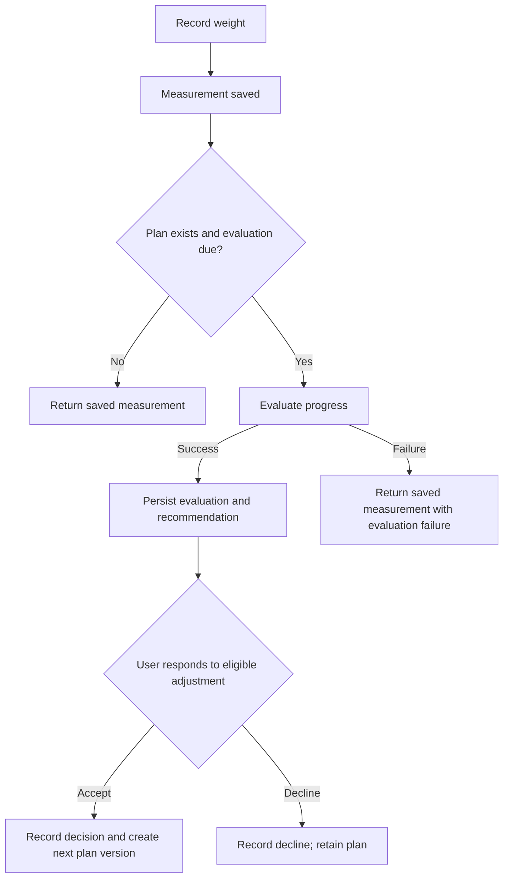
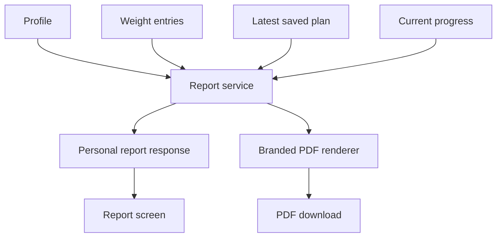

# NutriCare — Workspace and System Overview

This document describes the V3 authenticated workspace delivered in v0.5.0. It is intended for developers, QA reviewers and product demonstrations. Product requirements and detailed architecture decisions remain in the [V3 PRD](Docs/product/v3/01-prd-premium-experience.md) and [UX architecture RFC](Docs/product/v3/02-rfc-ux-architecture.md).

## System boundaries

NutriCare has two connected experiences:

- The public website introduces the product, learning resources and partnership opportunities, and accepts contact and partner inquiries.
- The authenticated workspace manages a user's profile, weight records, saved nutrition plans, progress guidance, history and reports.

The dashboard is a view of these capabilities, not the system's persistence or calculation layer. Personal data comes from authenticated APIs backed by PostgreSQL. Standalone calculations can run in the browser using shared calculation functions; persisted plans and progress decisions are handled on the server.

This is a logical architecture diagram. Route guards and authentication do not replace authorization inside each personal API. The server derives the account identity from the session and scopes access to that account.

## Ownership and persistence

| Information | Source and role |
| --- | --- |
| Profile | Persisted account context, including height, age, gender, activity and goal |
| Weight entries | Persisted measurements used for history, charts and service calculations |
| Nutrition plans | Persisted versions containing calculated targets and the saved goal |
| Progress evaluations | Persisted interpretation and recommendation linked to a plan version |
| Adjustment decisions | Recorded response to a particular evaluation; accepting an eligible adjustment creates a new plan version |
| Dashboard | Reads profile, measurements, plan and guidance; it does not persist a separate dashboard record |
| Report | Assembles existing account data at request time; PDF export renders that report |
| Standalone BMI result | Temporary browser calculation from explicitly entered height and weight; it does not create a weight or plan record |

Browser storage is not the authoritative store for the personal records above. Interface state, such as an open disclosure or selected chart period, is separate from persisted domain data.

Saved targets describe a historical plan. They are not food-intake measurements or proof of a health outcome. Historical BMI must not be reconstructed from old weights using today's profile height.

## API responsibilities

| Endpoint | Responsibility |
| --- | --- |
| `/api/profile` | Read and save the authenticated user's profile |
| `/api/weight-entries` | List or record the user's weight measurements |
| `/api/weight-entries/[id]` | Delete a measurement within the authenticated user's ownership scope |
| `/api/nutrition-plan` | Read the latest plan or generate a saved plan from persisted context |
| `/api/nutrition-plan/history` | Read saved plan versions |
| `/api/recommendations` | Build recommendations from eligible user context |
| `/api/progress` | Read current progress interpretation for the latest saved plan |
| `/api/progress/adjustment` | Accept or decline an eligible progress adjustment |
| `/api/report` | Assemble the personal report |
| `/api/report/pdf` | Generate the branded personal PDF |

`/api/recommendations` is not a universal calculation endpoint. Nutrition-plan generation, tracking, progress decisions and reporting have their own services and API boundaries.

## Dashboard loading

The dashboard loads profile, weight entries and the latest plan as its core data. Recommendations and progress have separate loading and recovery paths so a failed guidance read does not erase successfully loaded core information.

Loading, missing context, empty records and failed reads have different meanings and should remain distinguishable. Cancellation prevents obsolete requests from updating the interface. A read can refresh displayed information without generating a new saved plan.

Charts derive display data from measurements, including daily averages and seven-calendar-day means. Missing dates are not inserted as zero measurements. Chart aggregation is presentation logic; it does not replace the progress service's interpretation.

## Plan generation and progress

Plan generation uses persisted profile context and the latest measurement. Eligibility checks run on the server before the calculated plan is saved as a version. Opening Calories or Macros displays the shared nutrition-plan experience; it does not automatically save a fresh plan on every visit.

Weight recording saves the measurement first. If a current plan exists, the service checks whether progress evaluation is due. An existing evaluation is subject to a seven-day cadence. Evaluation failure after persistence must not be reported as a failed measurement save.

Decisions are checked against the user's evaluation and current plan. Stale recommendations and already recorded decisions are not valid new adjustments. An uncertain network response requires reconciliation with saved data before another write is attempted.

## History and reports

History reads weight measurements and saved nutrition plans independently. Lists render ten records per page; this bounds displayed rows, not the amount fetched from the API. Long notes and macro details use disclosures. Plan comparison shows newer minus older saved targets regardless of selector order.

The report service combines profile, weight entries, latest saved plan and current progress. When possible, it derives current BMI from the latest weight and current profile height. Missing measurements or targets stay explicit. The PDF renderer uses the same report structure and adds NutriCare branding, tables, wrapping and page footers.

## Security and deployment boundaries

Personal API authorization is based on the authenticated session, not a user ID supplied by the browser. Personal responses use private, no-store caching. Write endpoints apply origin checks; relevant request bodies are bounded and validated. Authentication includes rate-limit and CSRF protections.

These controls describe the implementation, not a claim that the platform is attack-proof. Open findings and verification limits are documented in the [security review](Docs/engineering/testing/v3-security-review.md).

Vercel hosts the current deployment. Node 22 is the repository runtime. Database TLS verifies the server certificate; the configured CA must be included in both route and proxy deployment bundles. `APP_URL` must match the intended browser origin for security checks and reset links. Production and Preview environment scopes require deliberate configuration.

See the [domain-change guide](Docs/engineering/deployment/domain-change.md) for deployment and future domain changes. Repository changes follow **working branch → PR into develop → release PR into main**, including documentation changes.

## Product demonstration

1. Sign in and save a profile. Explain that it provides context for personalised tools.
2. Record a weight measurement. Show the saved record before discussing progress guidance.
3. Generate a nutrition plan when the profile and measurement are eligible. Show calorie and macro targets as estimates.
4. Open Dashboard. Explain the difference between measurements, saved targets and service-derived guidance.
5. Add enough appropriate test data to demonstrate history and trends. Do not promise a progress adjustment after every measurement.
6. Compare saved plan versions and open a long note or macro disclosure.
7. Open Report and download the branded PDF.
8. Optionally demonstrate standalone BMI. Explain that this exploratory calculation does not save a measurement.

Use a designated demonstration account. Do not show another person's personal data or production credentials.

## Review and maintenance

Reviewers should verify persistence across reloads, account isolation, eligibility feedback, failed-read recovery, uncertain-write reconciliation and the effect of accepted or declined adjustments. Include empty and partial data, long histories, keyboard interaction, mobile layouts and PDF pagination.

The complete checklists and recorded evidence are maintained separately:

- [End-to-end guide](Docs/engineering/testing/end-to-end.md)
- [Manual regression checklist](Docs/engineering/testing/manual-regression.md)
- [Release evidence](Docs/engineering/testing/v3-release-evidence.md)
- [Design system](Docs/product/v3/03-design-system.md)

Update this overview when persistence, API ownership, plan versioning or report flows change. Keep execution results in release evidence rather than treating this architecture document as a test certificate.
